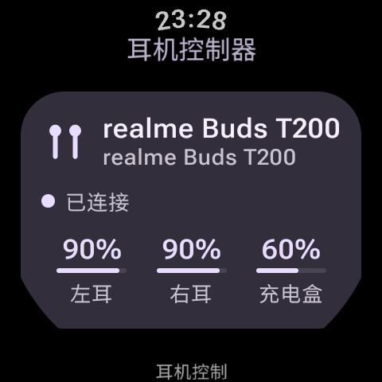
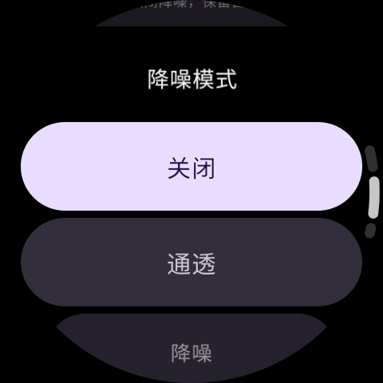
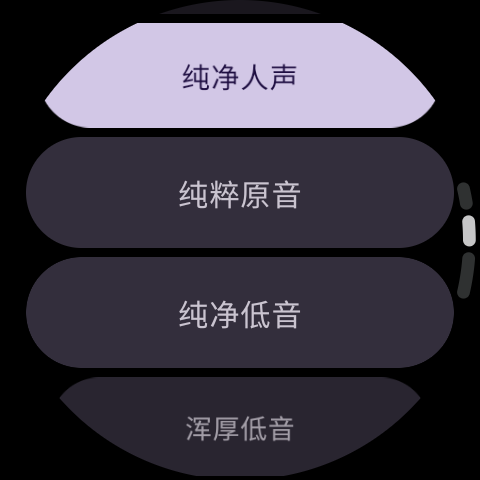
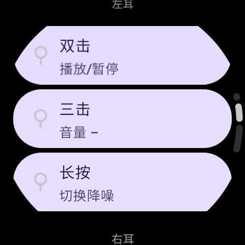
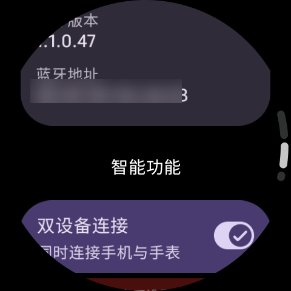
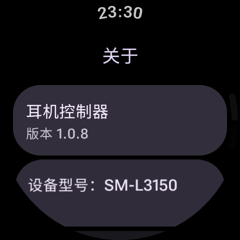

# 耳机控制器（Wear OS）· Buds Wear Controller

> 在 **Wear OS 手表**上直接控制 realme / OPPO 系 TWS 耳机的开源应用：降噪、音效、触控手势、游戏模式、双设备连接、电量与设备信息。
>
> **本项目是非官方开源项目，与 realme、OPPO、OnePlus 及其关联公司没有任何关系**；「realme」「OPPO」等商标归其各自所有者。协议信息来自对客户端行为的互操作研究，仅供个人学习与设备互操作使用。

    

| 主页（已连接） | 降噪控制 | 音效 |
|---|---|---|
|  |  |  |

| 触控手势 | 设备信息 | 关于 |
|---|---|---|
|  |  |  |

> 以上为真机截图（Wear OS 手表 + realme Buds T200）。

## 功能

- **降噪控制**：关闭 / 通透 / 降噪（支持等级的型号会自动出现智能/深度/中等/轻度）
- **音效**：纯净人声 / 纯粹原音 / 纯净低音 / 浑厚低音 / 明亮 / 动态（按耳机实际上报的能力生效）
- **触控手势**：左耳、右耳可分别配置双击 / 三击 / 长按
- **游戏模式**：低延迟开关
- **双设备连接**：耳机支持时自动显示开关
- **电量**：左耳 / 右耳 / 充电盒（未上报时隐藏或显示 `—`）
- **设备信息**：型号、固件版本、蓝牙地址
- **自动回连**：记住上次设备，打开应用自动连接；掉线后按退避策略重连
- **演示模式**：没有耳机也能完整体验界面

## 支持的耳机

本项目不是按型号白名单硬编码，而是按 **realme/OPPO 系私有协议**通用适配：

- ✅ **已真机验证**：`realme Buds T200`（降噪/音效/游戏模式/双设备/左右耳手势全部实际生效）
- 🟡 **理论支持**：采用同一协议族的 realme TWS（Buds T 系列、Buds Air 系列、Buds Q / Air Neo 等）与部分 OPPO/OnePlus Enco 系列；是否全部可用取决于该型号的命令支持子集，欢迎反馈实测结果
- ❌ **不支持**：非 realme/OPPO 品牌耳机（只能做标准 BLE 电量/信息读取），以及协议完全不同的头戴/颈挂型号

协议细节与实测命令表见 [docs/PROTOCOL.md](docs/PROTOCOL.md)。

## 工作原理（简述）

1. BLE 扫描并识别耳机 → 建立 GATT 连接（部分型号走经典蓝牙 RFCOMM 控制通道）；
2. 运行时自动探测帧方言：Telink 5 字节大端帧 / OPO 9 字节小端帧；
3. 通过统一命令集完成状态查询与控制，耳机上报的能力决定 UI 显示哪些选项；
4. 应用启动时自动回连上次成功连接的设备。

## 安装

1. 从 [Releases](../../releases) 下载签名 APK（或自行构建，见下）；
2. 手打开发者模式与无线调试（Wear OS：设置 → 系统 → 开发者选项 → 无线调试）；
3. 安装：

```bash
adb install -r buds-wear-controller.apk
adb shell am start -n com.cyhao.realmebuds/com.cyhao.realmebuds.MainActivity
```

> 首次打开默认为「演示模式」（模拟 realme Buds Air 6 Pro）。连接真实耳机请在「关于」中关闭演示模式，然后在主页点击「扫描并连接」。

## 构建

**环境要求**：JDK 17、Android SDK 36（compileSdk 36 / targetSdk 35 / minSdk 33）、Gradle 8.14.x（已在仓库内提供 `gradlew`）。

```bash
# macOS / Linux
export JAVA_HOME=/path/to/jdk17
export ANDROID_HOME=/path/to/android-sdk
./gradlew :app:assembleDebug

# Windows
set JAVA_HOME=C:\path\to\jdk17
set ANDROID_HOME=C:\path\to\android-sdk
gradlew.bat :app:assembleDebug
```

也可以直接用 Android Studio 打开项目（首次同步需联网下载依赖）。

> 注意：Wear Compose Material3 固定使用 **1.6.2**（1.7.x 需要 compileSdk 37 + AGP 9.1+，本仓库矩阵不兼容）；release 构建产物未签名，自行签名后分发。

## 项目结构

```
app/                      # 应用模块（Kotlin + Jetpack Compose for Wear OS）
  src/main/java/com/cyhao/realmebuds/
    data/                 # 状态模型、Repository、ViewModel（演示/真实实现）
    ble/                  # BLE/RFCOMM 传输、realme 协议编解码、命令表
    ui/screens/           # 7 个 Wear M3 页面
    ui/components/        # 通用 Wear M3 组件
    ui/theme/             # 主题（Wear M3 官方默认配色）
docs/                     # 设计、安装、协议、校准、AI 使用说明
gradlew / gradlew.bat     # Gradle Wrapper
```

## 关于 AI 生成（重要说明）

- 本项目**大量代码、文档与设计稿由 AI 编码智能体（DeepSeek Harness）在人工需求指导下生成**；
- 人工负责：需求定义、真机联调、协议抓包校准、真机功能验证与最终审查；
- 因此代码风格/结构可能带有 AI 生成痕迹，欢迎通过 Issue / PR 改进；
- 逆向分析得到的协议实现**不保证适用于所有型号**，仅供学习与互操作研究，请遵守当地法律与耳机厂商的条款；
- 详见 [docs/AI_USAGE.md](docs/AI_USAGE.md)。

## 已知限制

- 部分型号的降噪等级子档、手势「切换降噪」动作、恢复出厂设置尚未下发（命令未确认）；
- 「查找耳机」仅硬件支持该功能的型号有效（例如 T200 会接受命令但不会响）；
- 应用被杀掉后无后台常驻服务，重新打开会自动回连但无法在关闭时保持连接；
- 固件 OTA、空间音效、高清音质（LDAC）等高级功能尚未实现；
- Wear OS 低电量省电模式可能冻结后台，影响回连稳定性。

## 贡献

欢迎提交 Issue / PR：型号兼容性反馈（型号 + 可用的功能）、协议抓包、UI 改进、文档修正都很有价值。提交前请先看 [docs/CONTRIBUTING.md](docs/CONTRIBUTING.md)。

## License

[MIT](LICENSE)（仅覆盖本项目自有代码与文档；realme/OPPO 商标及耳机固件/协议归其所有者，本项目与官方无关。）
